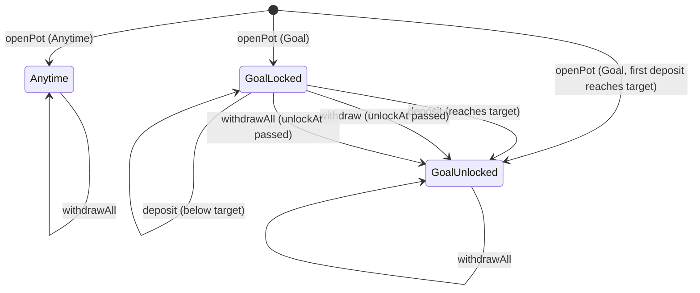
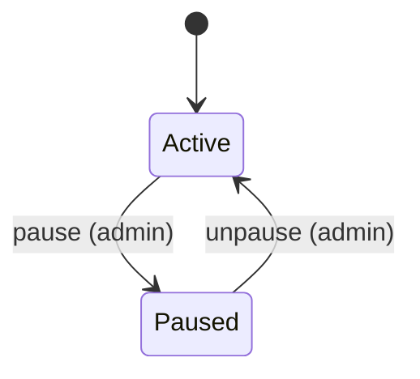
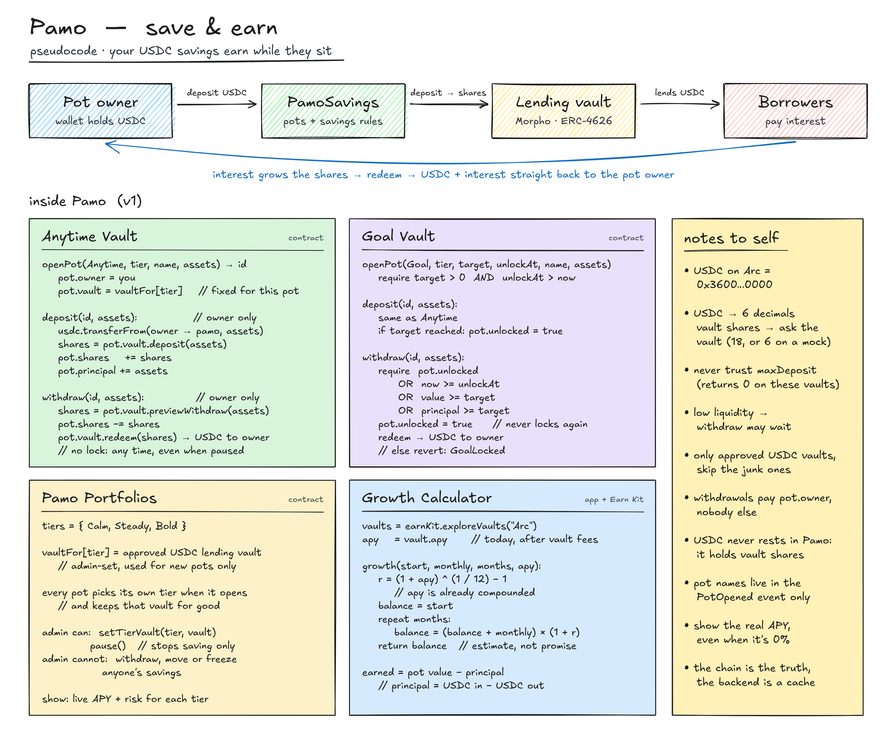
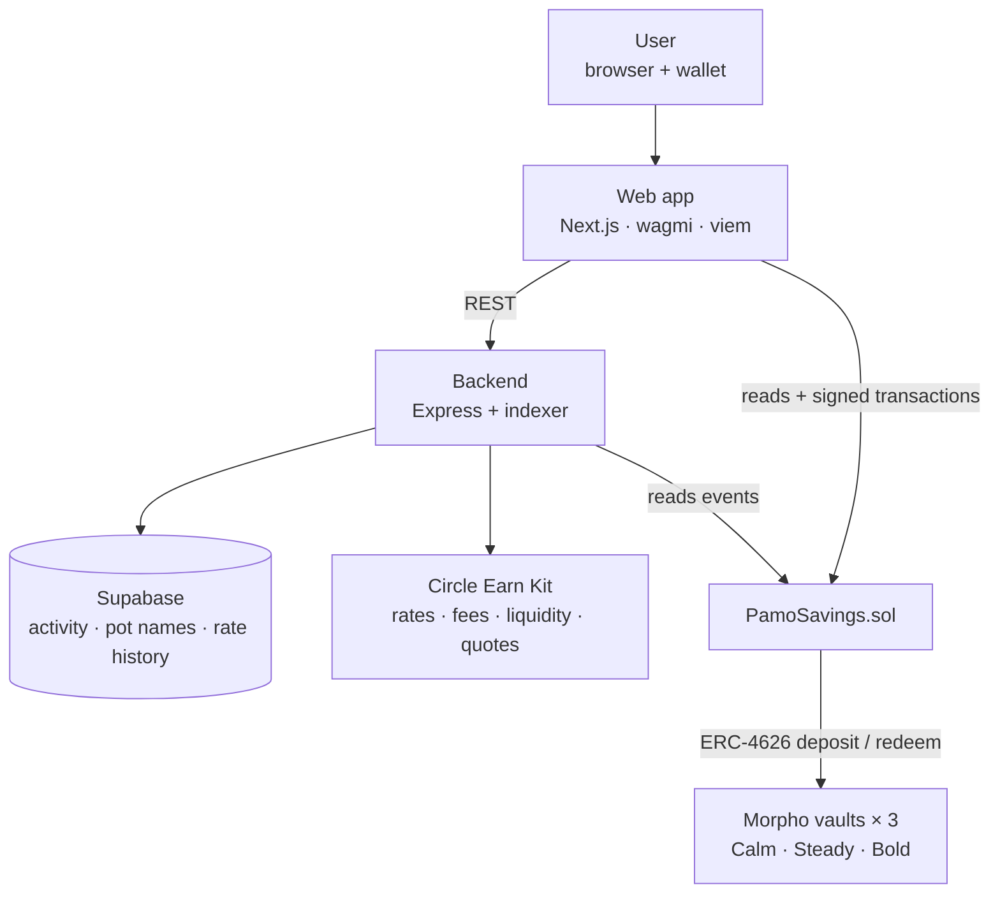
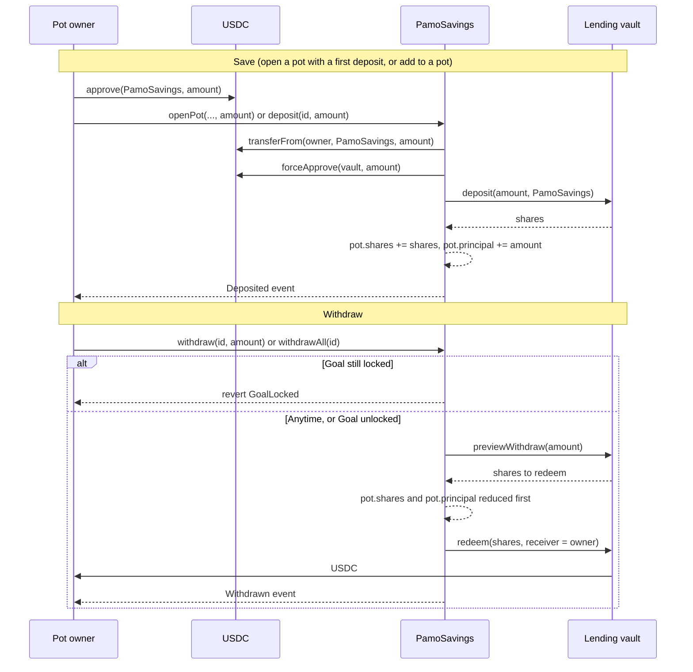

# Pamo

> *Keep it safe.* Savings pots for USDC: your money earns in a lending vault while it sits, and only you can take it out.

[](contracts/test)
[](contracts/src/PamoSavings.sol)
[](https://docs.arc.io/arc/tutorials/install-arc-foundry)
[](https://explorer.testnet.arc.io/address/0x9952E937378bb093DFA010e94FC81D56EC4cBF17)
[](#deployments)
[](web)

---

## Overview

Pamo is a save-and-earn app, currently on [Arc](https://docs.arc.io/arc-chain). You save USDC into **pots**, pick how each pot earns, and withdraw when the rules you set allow it.

- An **Anytime Vault** is a pot with no lock: add or withdraw whenever.
- A **Goal Vault** is a pot with a target amount and an unlock date. It stays locked until either is reached.
- A **Pamo Portfolio** (Calm, Steady or Bold) decides which USDC lending vault a pot's money earns in.

`PamoSavings` is the one contract behind it. It holds each pot's vault shares, enforces the goal lock, and pays withdrawals to the pot's owner and to nobody else. The admin cannot withdraw, move or freeze user funds.

The name comes from the Yoruba *fi pamọ́*, "keep it safe".

### Deployments

| Network | Chain ID | `PamoSavings` | Web app |
|---|---|---|---|
| Arc testnet | `5042002` | [`0x9952E937378bb093DFA010e94FC81D56EC4cBF17`](https://explorer.testnet.arc.io/address/0x9952E937378bb093DFA010e94FC81D56EC4cBF17) (source verified) | [pamosafe.vercel.app](https://pamosafe.vercel.app) |
| Arc mainnet | `5042` | Pending | Pending |

The live site runs on Arc testnet today. The mainnet address and explorer link are added here once the mainnet deploy is done, and the site moves to mainnet with it.

---

## Pot Lifecycle



Key rules:
- **Anytime**: the owner deposits and withdraws at any time. There is no lock.
- **GoalLocked**: deposits are accepted; `withdraw` and `withdrawAll` revert with `GoalLocked`.
- **GoalLocked → GoalUnlocked (target)**: a deposit that takes the money put in, or the pot's current value, to the target unlocks the goal.
- **GoalLocked → GoalUnlocked (date)**: once `block.timestamp >= unlockAt`, the next withdrawal succeeds and records the unlock.
- **GoalUnlocked is permanent**: a partial withdrawal that takes the pot back under its target does not lock it again.
- **No closed state**: an emptied pot keeps its id, tier and vault, and can take deposits again.
- **A pot's vault is fixed when it opens**: changing a tier's vault later only affects new pots.

The contract itself has one switch:



- **Active**: everything works.
- **Paused**: `openPot` and `deposit` revert. `withdraw` and `withdrawAll` keep working.

See [Docs/Architecture.md](Docs/Architecture.md) for the full system design and [Docs/Specification.md](Docs/Specification.md) for the product rules.

---

## Contract Functions

| Function | Auth | Description |
|---|---|---|
| `openPot(kind, tier, target, unlockAt, name, assets)` | anyone | Opens a pot for the caller and, if `assets > 0`, makes its first deposit in the same call. Returns the pot id. |
| `deposit(id, assets)` | pot owner | Pulls `assets` USDC from the owner into the pot's vault and credits the shares to the pot. |
| `withdraw(id, assets)` | pot owner | Redeems the shares that cover `assets` and sends the USDC to the owner. Works while paused. |
| `withdrawAll(id)` | pot owner | Redeems every share the pot holds and sends the USDC to the owner. Works while paused. |
| `getPot(id) → Pot` | none | One pot as a struct. |
| `getPots(owner) → PotView[]` | none | Every pot of one owner with its live value and lock state. |
| `potValue(id) → uint256` | none | USDC the pot's shares are worth now (6 decimals). |
| `isUnlocked(id) → bool` | none | Whether a withdrawal is allowed now. |
| `potCount(owner) → uint256` | none | How many pots an owner has opened. |
| `setTierVault(tier, vault)` | admin | Sets the vault a tier uses for **new** pots. |
| `pause()` / `unpause()` | admin | Stops or resumes new pots and deposits. |

---

## Data Structures

```solidity
struct Pot {
    address owner;      // the only address that can deposit to or withdraw from this pot
    Kind kind;          // Anytime or Goal
    Tier tier;          // Calm, Steady or Bold
    bool unlocked;      // Goal only: set once the goal first unlocks, never cleared
    uint64 unlockAt;    // Goal only: unix seconds
    address vault;      // ERC-4626 lending vault, fixed when the pot opens
    uint256 shares;     // vault shares held for this pot, in the vault's own decimals
    uint256 principal;  // USDC in minus USDC out (6 dp), for "earned"
    uint256 target;     // Goal only: USDC (6 dp)
}

struct PotView {
    uint256 id;
    Pot pot;
    uint256 value;      // USDC (6 dp) the pot's shares are worth now
    bool unlocked;      // whether a withdrawal is allowed now
}

enum Kind { Anytime, Goal }
enum Tier { Calm, Steady, Bold }
```

`earned = value − principal`. Pot names are not stored: they live only in the `PotOpened` event.

---

## Table of Contents

- [1. What is this project?](#1-what-is-this-project)
- [2. Who are the actors?](#2-who-are-the-actors)
- [3. Trust model](#3-trust-model)
- [4. Pot lifecycle in practice](#4-pot-lifecycle-in-practice)
- [5. Architecture](#5-architecture)
  - [5.1 System overview](#51-system-overview)
  - [5.2 Storage model](#52-storage-model)
  - [5.3 Events and the indexer](#53-events-and-the-indexer)
  - [5.4 USDC flow](#54-usdc-flow)
- [6. Fees and rounding](#6-fees-and-rounding)
- [7. Operational controls](#7-operational-controls)
- [8. Public API reference](#8-public-api-reference)
  - [8.1 Deployment](#81-deployment)
  - [8.2 Saving](#82-saving)
  - [8.3 Withdrawing](#83-withdrawing)
  - [8.4 Read-only views](#84-read-only-views)
  - [8.5 Admin](#85-admin)
  - [8.6 Backend REST API](#86-backend-rest-api)
- [9. Errors](#9-errors)
- [10. Security considerations](#10-security-considerations)
- [11. Testing strategy](#11-testing-strategy)
- [12. Repository layout](#12-repository-layout)
- [13. Getting started](#13-getting-started)
- [14. Roadmap](#14-roadmap)
- [15. Contributing](#15-contributing)
- [16. License](#16-license)

---

## 1. What is this project?

Most people who hold USDC let it sit idle. Earning yield onchain today means finding vaults, reading contract addresses and understanding DeFi jargon. That is too much for someone who just wants to save.

Pamo makes it simple: save any amount, set goals, and earn live lending yield, without giving up control of the money.

### What v1 does

| Feature | What the user does |
|---|---|
| **Anytime Vault** | Save USDC and take it out whenever they want |
| **Goal Vault** | Save toward a target amount with an unlock date. Locked until the target or the date is reached |
| **Pamo Portfolios** | Pick Calm, Steady or Bold, which decides which USDC lending vault the savings earn in |
| **Growth Calculator** | See what savings could grow to at today's live rate, no wallet needed |
| **Review screens** | See exactly what will happen before signing anything |
| **Dashboard and activity** | See total saved, earned so far, goal progress and history |

### Product rules

1. **Non-custodial.** Only the pot owner can withdraw. There is no admin path to user funds.
2. **Honest numbers.** Rates are live and labelled as today's rate, even at 0%. The calculator is always an estimate, never a promise.
3. **No surprises.** Every save and withdrawal goes through a review screen first.
4. **Plain language.** "Lending vault", "earned", "unlocks on". No jargon without an explanation.

### Pamo on one page



---

## 2. Who are the actors?

1. **Pot owner**
   - Opens pots, deposits and withdraws.
   - The only address that can touch a pot, and the only address a withdrawal can pay.

2. **Admin** (contract owner)
   - Sets which vault a tier uses for new pots.
   - Pauses and unpauses new pots and deposits.
   - Cannot withdraw, move or freeze user funds.

3. **Lending vault** (third party)
   - An ERC-4626 Morpho vault that lends USDC to borrowers and earns interest.
   - Run by a curator firm, not by Pamo.

4. **Backend** (Express, indexer and Supabase)
   - Serves live rates, review-screen quotes, activity history and pot names.
   - Holds no keys and signs nothing.

5. **Any caller**
   - Can read every view function. Pot data, including names, is public onchain.

---

## 3. Trust model

"Non-custodial" here means the contract, not a person, decides who can move money. What each party can and cannot do:

| Party | Can | Cannot |
|---|---|---|
| Pot owner | Deposit, and withdraw within the goal lock | Touch another owner's pot |
| Admin | Change a tier's vault for new pots; pause new pots and deposits | Withdraw, redirect or freeze funds; change an existing pot's vault; block withdrawals |
| Vault curator | Decide where the vault lends | Reach into Pamo: the contract only calls `deposit` and `redeem` |
| Backend | Cache and enrich what the chain says | Change a balance or gate a save or a withdrawal |

### 3.1 Vault trust

The savings earn by being lent out through a third-party vault. Pamo cannot verify a curator's lending decisions onchain. If a vault is short on cash, a withdrawal from it reverts until borrowers repay or new deposits arrive. The review screen warns about low liquidity before the user signs.

### 3.2 Admin trust

A compromised admin key could pause new deposits, or point a tier at a different USDC vault for **new** pots. It could not move money already saved, and it could not stop withdrawals.

On testnet the admin is a single key. The contract uses two-step ownership (`Ownable2Step`) and Safe is deployed on Arc, so the admin can be a multisig without a contract change.

### 3.3 Backend trust

The chain is the source of truth. If the backend and the chain disagree, the chain wins. If the backend is down, saving and withdrawing still work, because those calls go from the wallet straight to the contract.

---

## 4. Pot lifecycle in practice

1. **Opening**
   - `openPot` creates the pot for `msg.sender` and reads the tier's current vault.
   - A Goal needs `target > 0` and `unlockAt` in the future.
   - An Anytime pot ignores `target` and `unlockAt` and stores zero for both.
   - If `assets > 0`, the first deposit happens in the same call, so a first save is two signatures: allow, then save.

2. **Depositing**
   - `deposit` requires the caller to own the pot and `assets > 0`.
   - USDC moves from the owner to the contract, then into the vault.
   - The vault's shares are credited to the pot and `principal` grows by `assets`.
   - A Goal that reaches its target is marked unlocked.

3. **Withdrawing part**
   - `withdraw` requires the caller to own the pot, and a Goal to be unlocked.
   - The contract asks the vault how many shares cover `assets`, rounded up, and redeems them.
   - `principal` is reduced pro rata. The USDC goes to the pot's owner.

4. **Withdrawing everything**
   - `withdrawAll` redeems every share the pot holds.
   - It reverts with `NothingToWithdraw` on an empty pot.

5. **Unlocking a Goal**
   - A Goal is unlocked when any of these is true: the stored `unlocked` flag is set, `block.timestamp >= unlockAt`, the pot's value is at least the target, or the money put in is at least the target.
   - The flag is written on the deposit that reaches the target, or on the first withdrawal after the lock opens.

---

## 5. Architecture

### 5.1 System overview



| From | To | Why | Trust |
|---|---|---|---|
| Web app | Chain | Read pots and values, send signed transactions | Source of truth |
| Web app | Backend | Vault data, quotes, activity history | Helpful cache; the app works without it |
| Backend | Earn Kit | Live rate, fees, liquidity, quotes | Third party; cached, never blocks saving |
| Backend | Chain | Read contract events for the indexer | Source of truth |
| Backend | Supabase | Store and read indexed data | Pamo's own cache |
| Wallet | Chain | Sign and send transactions | Only the user holds keys |

### 5.2 Storage model

All contract state lives in `contracts/src/PamoSavings.sol`:

- `vaultFor[Tier] → address`: the vault new pots of each tier open in.
- `pots[id] → Pot`: every pot, by id.
- `potsOf[owner] → uint256[]`: the ids of one owner's pots.
- `nextId`: starts at 1 and only goes up.
- `USDC`: a constant, `0x3600000000000000000000000000000000000000`, the same address on Arc mainnet and testnet.
- `MAX_NAME_LENGTH = 64`: the longest pot name accepted, in bytes.

The backend keeps a cache in Supabase (`supabase/schema.sql`): `pots`, `activity`, `vault_snapshots` and `indexer_state`. The browser never talks to Supabase. Row Level Security is on with no public policies.

### 5.3 Events and the indexer

| Event | Emitted when | Fields |
|---|---|---|
| `PotOpened` | A pot opens | `id`, `owner`, `kind`, `tier`, `vault`, `target`, `unlockAt`, `name` |
| `Deposited` | USDC goes into a pot | `id`, `owner`, `assets`, `shares` |
| `Withdrawn` | USDC leaves a pot | `id`, `owner`, `assets`, `shares` |
| `TierVaultSet` | A tier's vault is set | `tier`, `vault` |

The indexer (`server/src/indexer.ts`) polls these events every 5 seconds, in ranges of 9,000 blocks, and writes them to Supabase. Inserts are keyed on `(tx_hash, log_index)`, so reading a range twice is safe. Every 10 minutes it stores a rate snapshot for each tier, which draws the rate history on the Portfolios page.

### 5.4 USDC flow



USDC moves in:

- `openPot` and `deposit`: owner → contract → vault.
- `withdraw` and `withdrawAll`: vault → owner. The USDC never rests in the contract.

The contract holds vault shares, not USDC. An invariant test checks that it never keeps idle USDC or a leftover vault allowance.

---

## 6. Fees and rounding

### 6.1 Pamo's fee

`PamoSavings` takes no fee. There is no fee parameter, no fee collector and no code path that sends USDC anywhere except a vault or a pot's owner.

### 6.2 Vault fees

Each lending vault sets its own performance and management fees, charged by its curator. The rate Pamo shows is the vault's rate today, after those fees. The review screen lists them before the user signs.

### 6.3 Network fee

Every transaction pays Arc's network fee, which is paid in USDC. The review screen shows an estimate.

### 6.4 Rounding

Vaults round in their own favour. A 1 USDC deposit is worth 0.999999 USDC a moment later. Two rules follow from that:

- `withdraw` redeems the shares that cover the amount, rounded up, so the owner can receive a few micro-USDC more than asked. `withdrawAll` empties the pot exactly.
- A Goal counts the money put in as well as the current value, so depositing exactly the target unlocks it.

---

## 7. Operational controls

### 7.1 Pause / unpause

`pause()` stops `openPot` and `deposit`. It does not touch `withdraw` or `withdrawAll`, which carry no pause check. The test `test_Pause_BlocksSavingNotWithdrawing` covers this.

### 7.2 Changing a tier's vault

`setTierVault(tier, vault)` rejects the zero address, an address with no code, and any vault whose asset is not USDC. It changes where **new** pots of that tier open. Existing pots keep the vault they opened with.

### 7.3 Admin rotation

Ownership moves in two steps: the current admin calls `transferOwnership(newAdmin)` and the new admin calls `acceptOwnership()`. A mistyped address therefore cannot take the role. To make the admin a multisig, set `OWNER` to a Safe address at deploy time, or transfer to it later.

---

## 8. Public API reference

### 8.1 Deployment

#### `constructor(initialOwner, calmVault, steadyVault, boldVault)`

- **Effects:** sets the admin and the three tier vaults.
- **Guards:** each vault must be a deployed contract whose `asset()` is USDC, or the deploy reverts with `InvalidVault`.

### 8.2 Saving

#### `openPot(kind, tier, target, unlockAt, name, assets) → id`

- **Auth:** anyone. The caller becomes the pot's owner.
- **Guards:** not paused; `name` at most 64 bytes; the tier has a vault; for a Goal, `target > 0` and `unlockAt > block.timestamp`.
- **Effects:** stores the pot, appends its id to `potsOf[caller]`, emits `PotOpened`. If `assets > 0`, deposits as below.

#### `deposit(id, assets)`

- **Auth:** the pot's owner.
- **Guards:** not paused; `assets > 0`; the vault returns at least one share.
- **Effects:** moves USDC owner → contract → vault, adds the shares and the principal to the pot, marks a Goal unlocked if it reached its target, emits `Deposited`.
- **Needs:** a USDC allowance for `PamoSavings` of at least `assets`.

### 8.3 Withdrawing

#### `withdraw(id, assets)`

- **Auth:** the pot's owner.
- **Guards:** `assets > 0`; a Goal must be unlocked; the shares needed must not exceed the pot's shares.
- **Effects:** reduces the pot's shares and principal, redeems the shares to the owner, emits `Withdrawn`.
- **Paused:** still works.

#### `withdrawAll(id)`

- **Auth:** the pot's owner.
- **Guards:** the pot holds shares; a Goal must be unlocked.
- **Effects:** sets the pot's shares and principal to zero, redeems everything to the owner, emits `Withdrawn`.
- **Paused:** still works.

### 8.4 Read-only views

- `getPot(id)`: returns the `Pot`.
- `getPots(owner)`: returns a `PotView` for every pot of one owner. The dashboard reads this in one call.
- `potValue(id)`: what the pot's shares are worth now, from the vault's `previewRedeem`.
- `isUnlocked(id)`: always `true` for an Anytime pot; for a Goal, whether a withdrawal is allowed now.
- `potCount(owner)`: the number of pots an owner has opened.
- `vaultFor(tier)`, `pots(id)`, `potsOf(owner, index)`, `nextId()`: the public storage getters.

### 8.5 Admin

- `setTierVault(tier, vault)`: see [7.2](#72-changing-a-tiers-vault). Emits `TierVaultSet`.
- `pause()` / `unpause()`: see [7.1](#71-pause--unpause).
- `transferOwnership(newOwner)` / `acceptOwnership()`: see [7.3](#73-admin-rotation).

### 8.6 Backend REST API

| Method + path | Returns |
|---|---|
| `GET /api/health` | `{ ok, indexedBlock, chainBlock }` |
| `GET /api/vaults` | Live rate, fees, liquidity and warnings for the three tier vaults |
| `GET /api/vaults/history?tier=` | Rate snapshots for one tier |
| `POST /api/quotes/deposit` | Share price, rate, fees, expected shares and warnings for a save |
| `POST /api/quotes/withdraw` | Value, lock state, shares to redeem, liquidity and the most that can be withdrawn now |
| `GET /api/owners/:address/activity` | Deposits and withdrawals for one owner |
| `GET /api/owners/:address/pots` | Pot names and settings for one owner |
| `GET /api/pots/:id` | Name and settings for one pot |

Inputs are validated with zod, requests are rate limited by IP, and CORS allows only the web app's origin.

---

## 9. Errors

The contract uses custom errors, defined in `contracts/src/PamoSavings.sol`:

| Error | Raised when |
|---|---|
| `NotPotOwner` | The caller does not own the pot |
| `ZeroAmount` | The amount is zero, or it rounds to zero shares |
| `NameTooLong` | The pot name is over 64 bytes |
| `TierNotSet` | The tier has no vault |
| `InvalidGoal` | A Goal has a zero target or an unlock time that is not in the future |
| `GoalLocked` | A withdrawal from a Goal that has not unlocked |
| `AmountExceedsValue` | A withdrawal needs more shares than the pot holds |
| `NothingToWithdraw` | `withdrawAll` on an empty pot |
| `InvalidVault` | A vault is the zero address, has no code, or does not hold USDC |

From OpenZeppelin: `EnforcedPause` (saving while paused), `OwnableUnauthorizedAccount` (an admin call from another address), `ReentrancyGuardReentrantCall` and `SafeERC20FailedOperation`.

A vault that cannot pay reverts the whole withdrawal with its own error and leaves the pot unchanged. The web app turns each of these into a plain message with an explorer link.

---

## 10. Security considerations

### 10.1 Authorization boundaries

- `deposit`, `withdraw` and `withdrawAll` check `pot.owner == msg.sender`.
- A withdrawal pays `pot.owner`. There is no recipient parameter.
- Admin functions use `onlyOwner`. None of them moves USDC or shares.

So knowing a pot's id gives nobody a way to move its money.

### 10.2 Reentrancy

Every function that moves money is `nonReentrant`. Withdrawals also update the pot's shares and principal before calling the vault.

### 10.3 Token handling

- USDC is used only through its ERC-20 interface, with 6 decimals. The contract never reads `msg.value` or its native balance.
- Transfers and approvals go through `SafeERC20`. The vault allowance is set to the exact deposit amount with `forceApprove`.
- Share decimals are never assumed: the mainnet vaults use 18, one testnet vault uses 6. Values come from `previewRedeem`.

### 10.4 Failure modes

- **A vault is short on cash.** Withdrawals from that vault revert until it has liquidity. Nothing is lost, but the money cannot be reached in the meantime.
- **The admin key is compromised.** See [3.2](#32-admin-trust).
- **The backend is down.** Rates show as unavailable; saving and withdrawing still work.

### 10.5 Audit status

> This contract has not been audited. Rates change daily and can be zero. Do not save more than you can afford to lose.

---

## 11. Testing strategy

44 tests, run with Arc Foundry against real vaults on a local fork of Arc mainnet. Plain Foundry cannot move USDC on an Arc fork, so `arc-forge` is required.

| File | Tests | What it covers |
|---|---|---|
| `contracts/test/PamoSavings.t.sol` | 29 | Every user and admin path, plus three fuzz tests |
| `contracts/test/PamoSavings.invariant.t.sol` | 4 | Invariants under random sequences of calls |
| `contracts/test/ForkSmoke.t.sol` | 8 | Arc and vault assumptions: USDC decimals, round trips through five real vaults |
| `contracts/test/PamoSavings.testnet.t.sol` | 3 | The full flow against the two testnet vaults, which differ in share decimals |

Selected tests:

| Test | What it verifies |
|---|---|
| `test_OpenWithFirstDeposit_OneCall` | A pot opens and takes its first deposit in one call |
| `test_EachTierUsesItsOwnVault` | Calm, Steady and Bold deposit into their own vaults |
| `test_DepositWithdrawPartThenAll_RoundTrip` | Money in, part out, the rest out |
| `test_Goal_RefusedWhileLocked` | A locked Goal refuses a withdrawal |
| `test_Goal_UnlocksOnDate` | A Goal unlocks at `unlockAt` |
| `test_Goal_UnlocksWhenTargetReached` | A Goal unlocks at its target |
| `test_Goal_StaysUnlockedAfterPartialWithdrawal` | An unlocked Goal does not lock again |
| `test_OnlyOwnerCanTouchAPot` | Another address cannot deposit to or withdraw from a pot |
| `test_AdminHasNoPathToUserFunds` | The admin cannot move user funds |
| `test_Pause_BlocksSavingNotWithdrawing` | Pause stops saving and leaves withdrawing alone |
| `test_SetTierVault_OnlyAffectsNewPots` | Existing pots keep their vault |
| `test_Withdraw_RevertsCleanlyWhenVaultCannotPay` | A vault that cannot pay leaves the pot unchanged |
| `test_TwoPotsInOneVault_StaySeparate` | Two pots in the same vault keep separate balances |

Invariants:

- `invariant_PotSharesMatchVaultBalances`: the shares recorded across pots equal the shares the contract holds in each vault.
- `invariant_NoIdleUsdcOrApprovals`: the contract keeps no idle USDC and no leftover vault allowance.
- `invariant_ThiefNeverSucceeds`: nobody but a pot's owner ever withdraws from it.
- `invariant_PrincipalNeverExceedsDeposits`: a pot's principal never exceeds what was put in.

---

## 12. Repository layout

```
contracts/    Foundry project: PamoSavings.sol, tests, deploy script
server/       Express API and event indexer
web/          Next.js app
supabase/     Database schema
Docs/         Specification, architecture, build guide, brand
```

Key files:

- `contracts/src/PamoSavings.sol`: the contract.
- `contracts/script/Deploy.s.sol`: one deploy script for testnet and mainnet.
- `server/src/index.ts`: the Express app and its routes.
- `server/src/indexer.ts`: reads contract events into Supabase.
- `server/src/earn.ts`: the Earn Kit client and its 60-second cache.
- `web/app/`: the routes. `/`, `/calculator` and `/portfolios` need no wallet; `/app`, `/app/new` and `/app/pot/[id]` do.
- `web/lib/contract.ts`: the ABI and the contract address.
- `supabase/schema.sql`: the cache tables.

---

## 13. Getting started

### Prerequisites

- [Arc Foundry](https://docs.arc.io/arc/tutorials/install-arc-foundry) (`arc-forge`, `arc-cast`)
- Node.js 22+ and pnpm
- A wallet with USDC on Arc testnet, from the faucet
- A Supabase project, only if you want activity history and pot names

### Contracts

```bash
cd contracts
git submodule update --init --recursive   # after a fresh clone
arc-forge build

# Run all 44 tests (fork tests read Arc mainnet over RPC)
arc-forge test --network arc

# 10,000 fuzz runs, before a deploy
FOUNDRY_PROFILE=deep arc-forge test --network arc
```

### Deploy

```bash
cp .env.example .env    # PRIVATE_KEY, the three tier vaults, optionally OWNER

arc-forge script script/Deploy.s.sol --rpc-url arc_testnet --network arc --broadcast

# → logs the PamoSavings address, save it
```

Verifying the source is covered in [contracts/README.md](contracts/README.md).

### Backend

```bash
cd server
cp .env.example .env    # the defaults point at the Arc testnet deployment
pnpm install
pnpm dev                # http://localhost:4000
```

Leave the three Supabase variables empty to run without the indexer and the history routes. To turn them on, run `supabase/schema.sql` in your Supabase project and fill them in.

### Web app

```bash
cd web
cp .env.example .env.local
pnpm install
pnpm dev                # http://localhost:3000
```

### Usage examples

Amounts are USDC with 6 decimals: `1000000` is 1 USDC. `Kind` is `0` Anytime or `1` Goal. `Tier` is `0` Calm, `1` Steady or `2` Bold.

```bash
export PAMO=0x9952E937378bb093DFA010e94FC81D56EC4cBF17
export USDC=0x3600000000000000000000000000000000000000
export RPC=https://rpc.testnet.arc.io
```

#### Allow USDC
```bash
arc-cast send $USDC "approve(address,uint256)" $PAMO 1000000 \
  --rpc-url $RPC --private-key $PRIVATE_KEY
```

#### Open an Anytime Vault with a first deposit
```bash
arc-cast send $PAMO \
  "openPot(uint8,uint8,uint256,uint64,string,uint256)" \
  0 0 0 0 "Rainy day" 1000000 \
  --rpc-url $RPC --private-key $PRIVATE_KEY
```

#### Open a Goal Vault (target 1,000 USDC, no first deposit)
```bash
arc-cast send $PAMO \
  "openPot(uint8,uint8,uint256,uint64,string,uint256)" \
  1 1 1000000000 $UNLOCK_AT "New laptop" 0 \
  --rpc-url $RPC --private-key $PRIVATE_KEY
```

#### Add money
```bash
arc-cast send $PAMO "deposit(uint256,uint256)" 1 1000000 \
  --rpc-url $RPC --private-key $PRIVATE_KEY
```

#### Read a pot's value and lock state
```bash
arc-cast call $PAMO "potValue(uint256)(uint256)" 1 --rpc-url $RPC
arc-cast call $PAMO "isUnlocked(uint256)(bool)" 1 --rpc-url $RPC
```

#### Withdraw part, then everything
```bash
arc-cast send $PAMO "withdraw(uint256,uint256)" 1 500000 \
  --rpc-url $RPC --private-key $PRIVATE_KEY

arc-cast send $PAMO "withdrawAll(uint256)" 1 \
  --rpc-url $RPC --private-key $PRIVATE_KEY
```

---

## 14. Roadmap

- [x] `PamoSavings`: pots, deposits, withdrawals, goal locks, tier vaults
- [x] Fork tests, fuzz tests and invariants against real vaults
- [x] Arc testnet deployment, source verified
- [x] Backend: live rates, quotes, event indexer, activity history
- [x] Web app: dashboard, new pot flow, pot page, review screens, portfolios, growth calculator
- [ ] Arc mainnet deployment with three live tier vaults
- [ ] Multisig admin
- [ ] Security audit
- [ ] Recurring auto-save
- [ ] Blended portfolios across several vaults
- [ ] Crosschain deposits and a fiat onramp
- [ ] Passkey and email sign-in, gasless saving
- [ ] A sharia-compliant savings option
- [ ] Team treasuries
- [ ] More chains
- [ ] Native mobile app

---

## 15. Contributing

Issues and pull requests are welcome. Before opening a pull request:

- contracts: `arc-forge fmt` and `arc-forge test --network arc`,
- server: `pnpm typecheck` in `server/`,
- web: `pnpm typecheck` and `pnpm build` in `web/`.

Changes to `PamoSavings.sol` need a test that fails without them.

---

## 16. License

MIT. See [LICENSE](LICENSE).

---

## Appendix: quick reference

### Constants and addresses

| | |
|---|---|
| USDC | `0x3600000000000000000000000000000000000000` (ERC-20 interface, 6 decimals) |
| `MAX_NAME_LENGTH` | 64 bytes |
| Arc testnet | chain ID `5042002`, RPC `https://rpc.testnet.arc.io`, explorer `https://explorer.testnet.arc.io` |
| Arc mainnet | chain ID `5042`, RPC `https://rpc.mainnet.arc.io`, explorer `https://explorer.arc.io` |

### Testnet tier vaults

Arc testnet has two vaults, so two tiers share one there. Testnet rates and liquidity are not real.

| Tier | Vault | Share decimals |
|---|---|---|
| Calm, Bold | EarnKit USDC Vault `0xaabbef1d3971c710276ed41ec791bbe14cdb8e88` | 18 |
| Steady | MockMorphoVault `0x8f2d33b5d4b9b5f02df635ae308f7b4c9da8d2dc` | 6 |

### Growth Calculator formula

```text
r = (1 + apy) ^ (1 / 12) − 1          // the yearly rate is already compounded
each month: balance = (balance + monthly) × (1 + r)
```

The result is an estimate at today's rate, never a promise.
